SYC项目

前端UI开发规范（试行版）

**中电信数智科技有限公司**

**2025年11月17日**

**变更记录**

<table><tbody><tr><td>
<strong>变更</strong>

<strong>序号</strong>
</td><td>
<strong>变更</strong>

<strong>状态</strong>
</td><td>
<strong>简要说明变更内容和变更范围</strong>
</td><td>
<strong>版本号</strong>
</td><td>
<strong>变更人</strong>
</td><td>
<strong>批准人</strong>
</td><td>
<strong>生效日期</strong>
</td></tr><tr><td>
1
</td><td>
C
</td><td>
初稿
</td><td>
0.1
</td><td>
周齐
</td><td></td><td>
2025.11.17
</td></tr><tr><td></td><td></td><td></td><td></td><td></td><td></td><td></td></tr><tr><td></td><td></td><td></td><td></td><td></td><td></td><td></td></tr><tr><td></td><td></td><td></td><td></td><td></td><td></td><td></td></tr></tbody></table>

统计界面与交互设计规范‘旨在统一整体视觉风格和交互方式，确保通过组装组件生成的应用系统，具有统一良好外观、方便的交互和高效的性能，为业务用户提供良好的体验。微应用、低代码应用和混合应用建议遵循本章节规范，以保持统一的界面和交互风格。

# **色彩**

用户界面的色彩体系主要定义主色板、辅助色板和中性色板，来源于框架采用的主要组件库viewUI的基础色盘。色彩的总体原则以灰蓝白简约（#17233d、#2d8cf0、#ffffff）为主色，辅助色包括点击、特殊场景、浅色、边框等场景的色彩，中性色包括菜单背景、标题、页面、模块、分割线、边框、提示、辅助文字等场景的色彩。

## **主色**

使用较为安全的蓝色作为主色调，其中Light Primary常用于hover，Dark Primary常用于active。

## **辅助色**

辅助色是具有代表性的颜色，常用于信息提示，比如成功、警告和失败。

## **中性色**

中性色常用于文本、背景、边框、阴影等，可以体现出页面的层次结构。

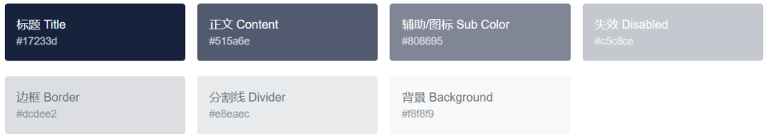

## **色彩样式示例**

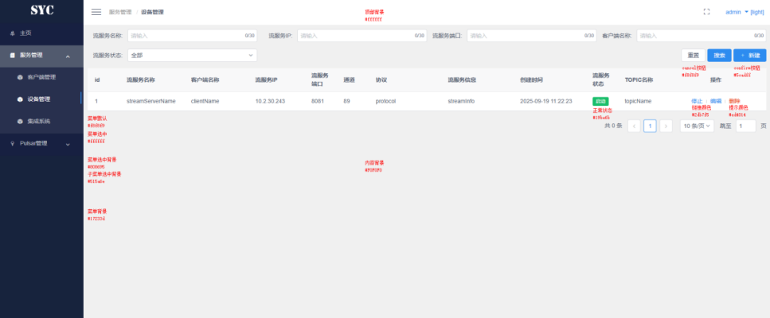

# **字体字号**

## **字体样式**

系统对字体进行了统一规范，力求在不同平台、浏览器下能显示出其最佳的效果。Windows系统以微软雅黑为主、Mac系统以苹方字体为主，在不支持苹方字体的情况，使用备用字体。

font-family: "微软雅黑","Helvetica Neue",Helvetica,"PingFang SC","Hiragino Sans GB","Microsoft YaHei",Arial,sans-serif;

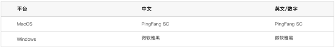

## **字号**

字体层级与字重的统一是保障页面可读性、视觉一致性的核心要素。为明确不同场景下的字体使用标准，结合内容重要性与视觉层级逻辑，制定本规范，所有设计与开发需严格遵循，确保全平台字体表现统一。

平台字体大小以2px递增为基础逻辑，不同层级对应明确的使用场景，具体规则如下：

32px用于特殊强调；20px用于主标题和一级标题；18px用于二级标题；16px用于栏目三级标题；14px用于正文描述；12px用于解释说明。

其中粗体字重（500/600）用作标题或强调，常规字重（400）。

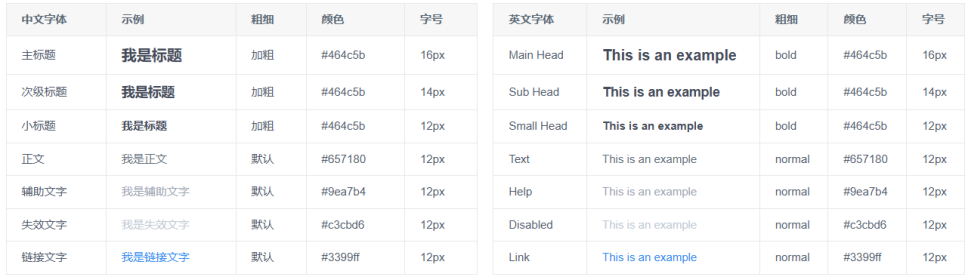

## **字体字号样式示例**

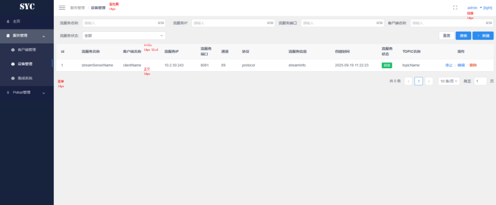

# **导航菜单**

菜单须采用“常用-主要-次要-工具-帮助”的位置排列；

下拉菜单须根据菜单选项的含义进行分组，并且按照一定的规则进行排列，用横线隔开；

一组菜单的使用有先后次序或向导作用时，应该按次序排列，没有次序要求的菜单项，按使用频次和重要性排列，频次高、重要的优先，频次底、次要的劣后；

菜单选项较多，须优先加长菜单长度，尽量减少深度；

菜单深度须控制在三层以内；

主菜单数目不应太多，最好为单排布置；主菜单的宽度需接近，字数不应多于四个，尽量每个菜单的字数相等。

## **一级菜单**

一级菜单宽度为64px-208px，整体背景体系按选中状态区分，未选中时背景色统一为#17233d，保持界面基础视觉一致性；选中状态下将显示专属高亮框，该高亮框背景色为#808695，内部文字字号为14px，通过明确的色彩对比和规整的尺寸设计，让用户快速识别当前激活的一级菜单，提升操作辨识度。

## **二级菜单**

二级菜单宽度为64px-208px，高度根据菜单内文字内容自适应调整，确保不同长度的菜单文本均能完整展示，内部文字统一采用14px字号，保障阅读舒适度；背景色同样按选中状态差异化设计：未选中时背景色为#515a6e，营造清爽的次级导航视觉体验；选中状态下显示专属高亮框标识物色块，颜色为#5cadff，高亮框背景色为#515a6e，通过与一级菜单形成呼应的 “选中显示框” 设计，既保持了导航体系的视觉统一性，又能清晰区分二级菜单的激活状态，优化多层级导航的操作体验。

## **菜单样例**

菜单应规划明晰，避免冗余功能和复杂的排版，根据功能重要性突出主次功能，避免给用户带来使用不便和困扰；

初始菜单设置为二级可展开菜单，某一级菜单展开同时收缩其他菜单；一级菜单下设二级菜单，功能上支持二级可展开至三级菜单，但从用户使用方便程度和视觉混淆角度上考虑应避免，简洁可增加用户的接受程度；

左侧菜单区域默认为展开状态，点击菜单面包屑左侧图标可进行收起，使用图标菜单代替文字菜单，为内容区域提供更多使用范围，如下图。

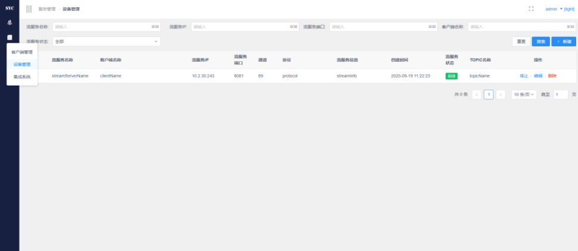

# **布局**

## **界面布局设计及交互原则**

界面布局须保持一致性，同类型的内容应以相似的方式呈现，布局和样式应该保持一致，提供一致的用户体验，减少用户的混淆和学习成本；

界面布局应清晰简洁、重点突出，避免过多的元素和复杂的排版，突出重要的内容和功能，避免给用户带来混乱和困扰；

界面布局应以遵循用户的思维方式和操作习惯，关键功能和内容应易于找到和访问，操作流程应简单明了；

界面布局应适应不同屏幕尺寸和设备，建议采用自适应和流式布局，使界面能够在各种设备上保持良好的表现；

界面布局应合理运用空白和间距，使界面更清爽和易读。建议通过适当留白，帮助组织内容和功能，增强用户的视觉感受和可理解性。

## **标准界面布局**

为确保平台界面在不同设备及显示环境下均能保持布局完整、内容清晰及交互流畅，结合主流设备配置与用户使用场景，特明确以下三类核心推荐布局分辨率。所有设计与开发工作需以该分辨率体系为基础，兼顾响应式适配，保障多场景下的一致用户体验。

优先级1：1920×1080（全高清），此分辨率为当前主流台式机、笔记本电脑的标准配置，覆盖约60%的办公及个人使用场景，是平台界面的基准设计分辨率。

优先级2：1440×900（高清），此分辨率常见于14-15英寸笔记本电脑及中端台式机，覆盖约25%的使用场景，是平台界面的核心兼容分辨率。

优先级3：1366×768（普清），此分辨率为入门级笔记本电脑、老旧台式机的主流配置，覆盖约12%的使用场景，是平台界面的基础兼容分辨率，需重点保障核心功能可用。

典型布局方式：可根据页面内容选择相应布局方式；

上下布局：布局整体方式为上下结构，一级菜单在上，二级菜单及辅助菜单在下方；

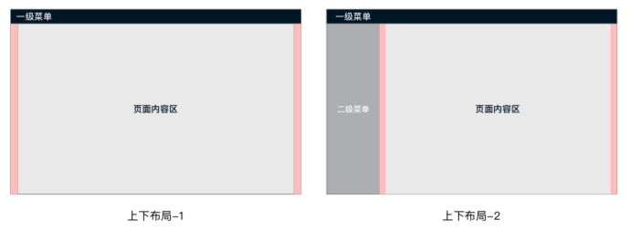

左右布局：布局整体方式为左右结构，一级菜单在左侧，二级菜单及辅助菜单在右上方及右侧。

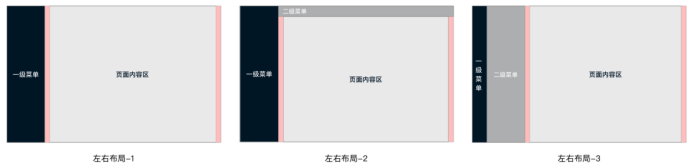

布局示例：

布局样式示例（一级菜单）

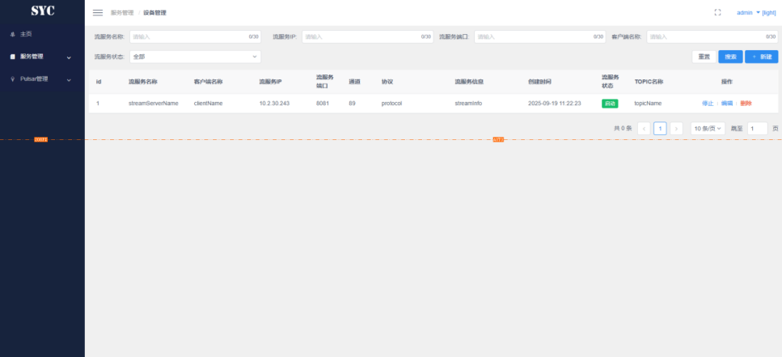

布局样式示例（二级菜单）

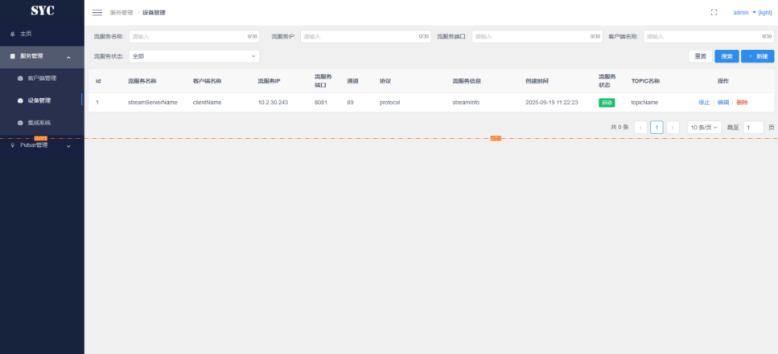

布局样式示例（组件间距）

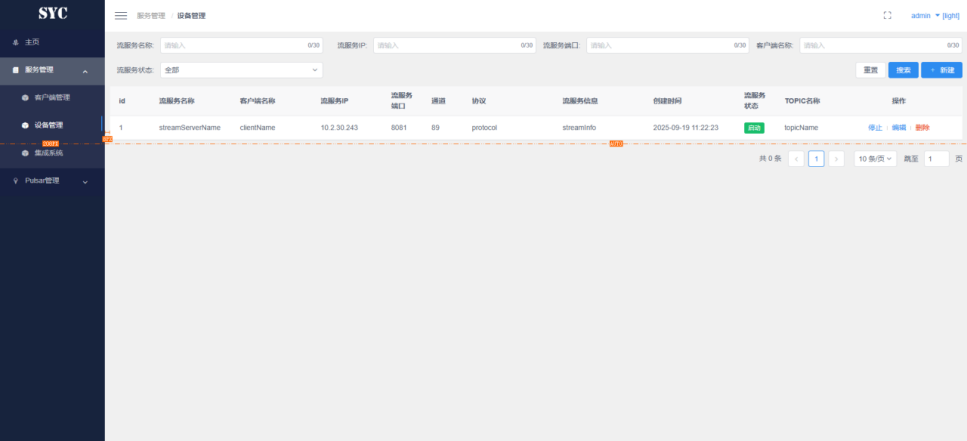

## **栅格及间距**

栅格：栅格作为页面内容区的核心分割工具，其核心价值体现在三个方面：一是实现视觉重量感平衡，通过规整的网格划分，让不同模块的布局比例协调，避免页面杂乱无章；二是提升布局一致性，确保不同页面、不同模块的内容排列遵循统一基准，降低用户认知成本；三是提高协作效率，为设计师与前端开发人员提供统一的布局参考标准，减少沟通偏差，保障设计稿1:1还原。

间距：通常使用的间距为8px、16px、24px......(8n)px；

8px：最小基础间距，适用于元素内部紧凑空间（如按钮内图标与文本的间距、表单输入框的内边距、标签内部的间距），以及小型组件之间的间距（如复选框与文本的间距）；

16px：常用基础间距，适用于同层级小型模块之间的间距（如表单字段组之间的间距、卡片内部子元素的间距、导航菜单项的内边距），是平衡紧凑性与可读性的核心间距；

24px：中等级间距，适用于同层级大型模块之间的间距（如页面内不同功能区域的间距、卡片与卡片的间距），以及页面容器的内边距（如1920×1080分辨率下页面左右边距的基础参考）；

32px及以上：大间距，适用于页面级的分隔场景（如顶部导航与内容区的间距、页面底部版权区与内容区的间距），以及需要重点突出的模块与其他元素的间距（如数据统计卡片与普通内容区的间距）。

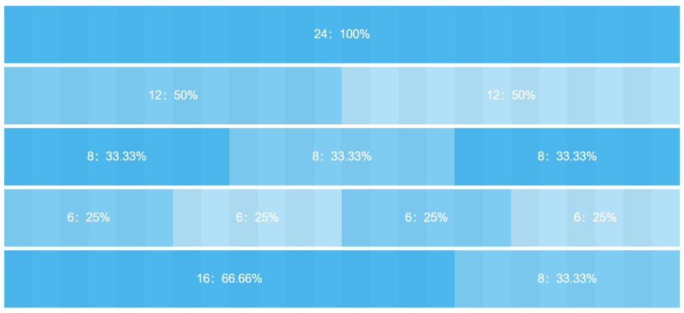

## **界面内容区域说明**

根据以上标准和UI提供的物料，以下是初步的界面方案以及说明。

（请注意，以下途中所展示页面结构、功能、内容为临时说明使用，并不代表未来实际系统的真实页面结构、功能、内容）

登录页

内容页

内部页面由三部分构成，左侧为可收缩的菜单区域，右上为基础功能区域，其余则为主要内容区域；

菜单区域为用户提供便捷的不同模块内容的跳转功能；

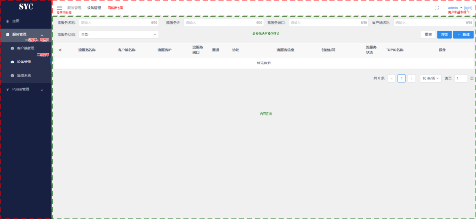

基础功能区域为用户提供直观的模块路径，以及用户基础功能以及系统自身功能的操作入口；

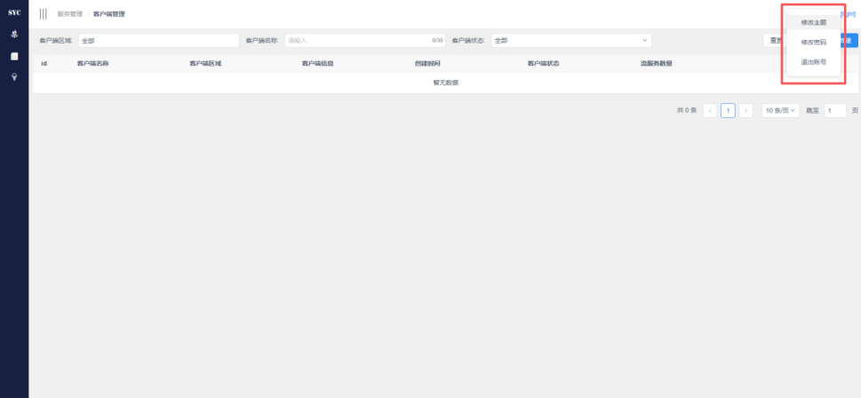

主要内容区域则为系统为用户提供的内容展示操作区域，可渲染展现各种形式内容；

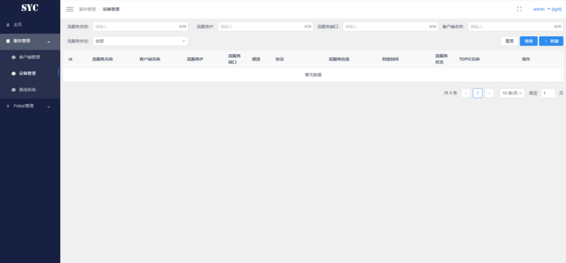

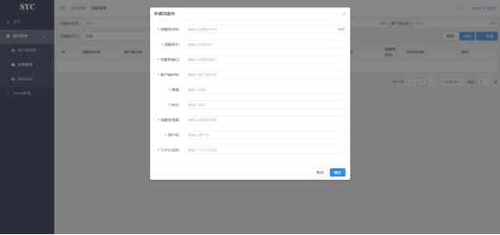

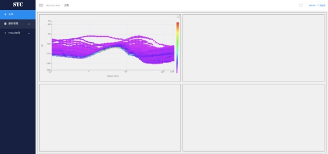

表格页：筛选条件一行4列，操作按钮在最后一列，若4列已满则另起一行放置在最后一列，表格数据需设置加载图标与空数据提示；

信息页：左侧label，右侧信息或功能框，居左显示；

弹窗：宽度由内容自主决定，点击空白不可关闭，顶部距离页面30px，需要设置右下取消按钮与右上“x”按钮，添加和修改内容时需设置“确定”按钮。

## **界面布局缩放说明**

系统页面设置有缩放，由于现代客户端设备本身可能会对视窗进行不同程度的缩放（devicePixelRatio），系统页面为统一视觉体验，会对渲染后的视窗进行缩放设置（zoom），暂定比例为clientWidth/1920；

缩放设置可能会对定位、charts(canvas)、gis等产生影响，系统页面对此进行了补偿设置，如依然出现错位问题，需进一步协商联调；

适用于PC端设备；

适用于便携大屏设备。

# **样式规范**

规范的样式保障系统视觉统一性及用户体验一致性的核心，请确保样式文件的集中性、统一性、复用性。

## **样式要求**

UI设计师需基于本规范与viewUI组件库输出设计稿，标注“色彩+字体+间距+边框+圆角”等属性，设计稿评审需检查规范符合性；

前端开发使用规范的样式变量开发，使用统一组件库，禁止自定义污染核心样式。

## **主题适配规范**

平台支持“默认主题（light）”与“暗色主题（dark）”双主题切换覆盖全局样式，核心原则保持结构不变、色彩反转、层级保留，未来可发布新主题；

微应用系统或嵌入系统接收基座系统主题参数“theme”变更相应主题，需监听此参数。

## **样式命名**

语义化优先：名称需准确反映元素的功能/用途或位置，避免无意义的缩写（如按钮样式按惯例命名为.btn而非.b、拼音、随机字符如.x123）；

简洁性：在语义清晰的前提下简化命名，避免冗余（如菜单样式名称按惯例命名为.nav而非.navigation、提交按钮按惯例命名为.submitBtn而非.submitButton）；

一致性：全系统遵循统一命名规则，避免同一类型元素多种命名方式；

隔离：微前端样式有沙箱隔离，但每个分系统最好还是统一前缀或后缀进行隔离，以方便后续代码debug或联调。

# **前端页面元素细节规范**

规范的对页面中常用元素的细节进行了普适性的规范，无特殊情况请优先按照本规范进行开发，如特殊功能（如大屏等）按照UI设计图、原型、规范的优先度进行处理，细节内容会随进度推进添加。

页面整体元素基于viewUI组件库，依赖版本为4.4.0。

页面图表库基于echarts库，依赖版本为^5.3.3。

## **基础**

1.  **按钮（Button）**

尺寸规范：默认使用viewUI组件库标准Button，长按钮宽度按照设计；

状态样式：主要按钮状态type="primary"，次要按钮状态无，禁用状态增加属性disabled不可点击；

图标搭配：带图标的按钮，图标与文字间距8px，图标尺寸16×16px；

位置规则：操作组中，主要按钮（确认、提交）居右，次要按钮（取消、重置）居左，按钮间距8px。

1.  **图标（Icon）**

基本规范：优先使用字体库类型图标，可以引入第三方自定义图标，图片优先使用svg、png，特殊情况按照设计使用；

图标搭配：搭配文字，图标大小应与文字大小间隔呼应。

## **引导**

1.  **分页（Page）**

分页配置：默认10条/页，支持10/20/50条/页切换，显示当前页/总页数及总数据量；

快速跳转：默认附带分页组件电梯功能，可进行快速跳转到某一页，如果输入超限页码则会跳至第一页；

特殊配置：对于异型列表需要按照设计要求进行特殊条数切换或使用迷你型分页。

## **表单**

1.  **输入框（Input）**

字符限制：单行输入框默认最多输入200个字符，特殊场景（如备注、描述）可扩展至500字符，需明确标注上限，或按设计标注；

剩余字数提示：实时显示已输入字符数/总限制（如“0/200”）；

输入格式校验：手机号、邮箱、IP、端口等特殊类型输入框，实时校验格式并给出错误提示；

占位提示：占位文字需明确输入要求（如“请输入用户名”、“请输入11位手机号”、“请输入合法IP地址”）；

禁用状态：通过添加disabled属性可设置为不可用状态，不可点击且无输入光标。

1.  **文本域（Textarea）**

字符限制：默认最多输入500字符，特殊场景可扩展至1000字符，实时显示剩余字数，或按设计标注；

尺寸适配：默认高度3行，支持拉伸，支持滚动条；

换行规则：默认自动换行，输入内容超出宽度时自动折行，保留原始换行符；

占位提示：明确标注输入用途占位词及格式要求（如“请输入详细描述，最多500字”）。

1.  **下拉菜单（Select）**

搜索功能：所有下拉菜单默认支持关键词搜索，搜索结果实时筛选，无匹配结果时显示 “无匹配数据”；

默认选中：需设置合理默认值（如“请选择”），默认值即为全部且不可删除；

多选支持：多选下拉需显示已选标签，标签可单个删除，未选择即为“全选”；

下拉高度：下拉面板默认最多显示6个选项，超过时出现滚动条，面板宽度与输入框一致。

1.  **单选框（Radio）**

布局规范：横向排列或按设计；

选中样式：选中时圆点颜色为主题色#2d8cf0，未选中时为中性色#c3cbd6，禁用状态灰度处理；

默认选中：必须设置默认选项，无特殊要求时默认选中第一个有效选项；

互斥规则：同一组内仅能选中一个，选中新选项时自动取消原选中项。

1.  **复选框（Checkbox）**

组合规则：复选框组选项超过5个需增加全选功能，全选状态下再次点击则取消全选，全部置为未选择；

选中样式：选中时图标颜色为主题色#2d8cf0，未选中时为中性色#c3cbd6，禁用时图标灰度处理；

布局方式：横向排列或按设计；

关联逻辑：若存在互斥选项，需明确标注并限制只能选择其一或其他标注。

1.  **开关（Switch）**

默认状态：未选中为默认状态（value=false），选中状态需通过业务逻辑明确配置，不可默认选中关键功能开关；

交互逻辑：点击开关任意区域（含滑块、背景）均可切换状态，切换时无二次确认（关键操作需按设计搭配弹窗确认）；

状态回调：状态变更时实时触发回调事件，同步更新关联数据及页面展示，确保状态一致性。

1.  **表格（Table）**

基本配置：默认开启斑马纹stripe，默认开启边框border，每行第一列数据需按照分页信息自行对每条数据进行编序；

排序功能：对于有排序需要的数据列支持点击表头升序/降序排序，排序时显示箭头图标（升序↑、降序↓），未明确需求时为本页数据排序；

筛选功能：筛选支持下拉、多选、关键词搜索，可一键重置为初始状态；

空数据提示：无数据时显示 “暂无数据” 文字，居中展示；

加载状态：数据加载时显示加载动画，覆盖表格区域，避免用户重复操作；

行操作：行内操作按钮（编辑、删除、查看等）中间灰色短线间隔，间距8px。

1.  **日期选择器（DatePicker）**

选择范围：支持单日、日期区间选择，默认显示占位提示；

禁用日期：根据业务逻辑标注禁用日期（如过去日期、未来日期），禁用日期灰度显示，不可点击；

格式规范：日期显示格式统一为 “YYYY-MM-DD”，时间选择器格式为 “HH:mm:ss”，日期时间组合格式为 “YYYY-MM-DD HH:mm:ss”；

范围时间：前端展示“YYYY-MM-DD”而后端需要“YYYY-MM-DD HH:mm:ss”时，前端需拼接为，例：“2025-12-12 00:00:00” “2025-12-12 23:59:59”。

1.  **上传组件（Upload）**

格式限制：明确标注支持的文件格式（如“支持.jpg/.png/.pdf，单个文件≤5MB”），上传不支持格式时提示错误；

上传状态：上传成功/失败分别显示对应图标及提示文字，大文件需要按照设计规划显示上传进度条（百分比）；

预览功能：上传图片文件时如果设计需要预览需要按照设计展示已上传图片。

## **视图**

1.  **弹窗（Modal）**

关闭规则：仅支持点击右上角 “×” 按钮或下方 “取消” 按钮关闭，点击弹窗空白区域不关闭；

尺寸适配：弹窗宽度根据内容自适应（最小宽度400px，最大宽度不超过屏幕宽度的85%），顶部距离页面30px；

表单校验：弹窗内表单提交前需做完整性校验，必填项未填时标红提示并展示红色文字提示；

按钮布局：下方右侧放置“取消”、“确定”按钮，间距8px，“确定”按钮为主题色样式，“取消”为中性色样式；

滚动处理：弹窗内容高度自适应，使用视窗纵向滚动条。

1.  **标签（Tag）**

样式规范：默认标签为组件库提供默认中性色版本；

可删除标签：带删除功能的标签右侧显示“×”图标，点击删除时无二次确认；

展示：多个标签横向排列，间距8px，超出容器宽度时自动换行；

状态区分：不同类型标签（如成功、警告、禁用）对应组件库辅助色体系，或者按照设计或原型进行配置。

1.  **提示组件（Tooltip/Message）**

Tooltip：鼠标悬浮时显示，延迟0.5秒触发，消失延迟0.2秒；

Message：提示框分为成功、警告、错误、信息四类，对应辅助色，左侧显示对应图标，默认自动关闭，特殊设计时也可支持手动关闭（带“×”按钮）；

位置规范：Tooltip优先显示在元素上方，Message固定显示在页面顶部，新消息叠加在旧消息的上方。

1.  **树形控件（Tree）**

数据展示：支持多层级数据展示，默认展开一级第一个节点，层级缩进距离为16px，通过缩进区分父子关系；

选择功能：支持多选，多选时节点前显示复选框，勾选父节点自动勾选所有子节点，取消父节点勾选自动取消所有子节点勾选；

展开/折叠：点击节点左侧箭头或节点文字可展开/折叠子节点，同级节点同一时间默认只能展开一个节点，如有特殊设计需按设计配置；

懒加载：当树形数据层级深、数据量大时，启用懒加载模式，点击展开节点时加载对应子节点数据，加载中显示加载动画；

图标配置：不同类型节点可配置专属图标（如文件夹、文件图标），图标尺寸16×16px，图标与节点文字间距8px，无图标时节点文字左对齐；

空数据处理：无数据时显示“暂无数据”提示文字。

# **前端集成方式**

## **基座应用**

基于微前端进行集成，基座应用由Vue2.x编写，组件库viewUI为主库，elementUI库作为补充，不同的分系统由微前端方式进行集成，请安装qiankun依赖；

npm install qiankun --save

系统本身也是qiankun微前端的基座应用，内容区域即为分系统的子应用的展示区域，如分系统有独立运行的需求，则需要区分状态，进行切头或隐藏功能的配置；

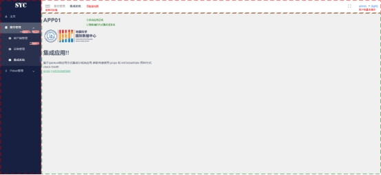

基座应用本身变量或样式不会污染或继承给子应用，但子应用还需增加或配置识别方式，方便后续debug或联调；

基座应用的nginx需支持history模式路由以解决刷新404问题。

## **集成应用规则**

综上要求，子应用编写不限制框架，但风格应与基座应用风格保持一致，开发环境与生产环境的entry地址应保持稳定性与一贯性；

以Vue框架为例，微应用Router的模式应为mode: 'history'；

微应用的静态资源调用需要增加entry地址的前缀，如子应用有独立运营要求，需处理好不同环境的配置；

Vue.prototype.$imgBaseUrl = imgBaseUrl ? imgBaseUrl : ''

基座应用加载微应用时，理论上会存在跨域问题，需在微应用的开发服务器中配置 CORS 允许基座域名访问，例如；

// 允许基座域名访问（\*表示允许所有，生产环境需指定具体域名）

headers: { 'Access-Control-Allow-Origin': 'http://localhost:8080' }

部署时微应用的nginx需配置CORS，允许基座域名访问；

如子系统开发方式不支持微应用方式改造，则使用基于iframe的方式进入嵌入，数据传输需另行对接联调。

## **应用共享信息说明**

通过props方式向微应用传输数据，基座在注册微应用时通过props传值，微应用在mount钩子中接收，适合传递用户信息、配置项等静态/少量参数；

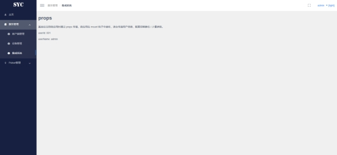

通过globalState方式向微应用传输数据，传递动态变化的参数（如全局状态、菜单权限），或需要微应用与基座/其他微应用通信，用qiankun提供的initGlobalState全局状态管理，支持“发布-订阅”模式；

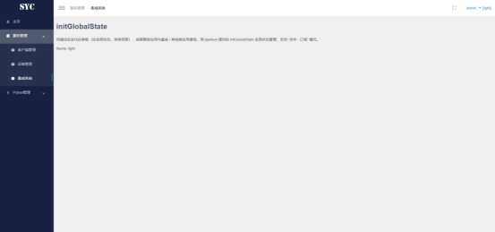

基座向子应用发布的数据包括不限于用户信息、用户权限、系统主题、登录令牌、相关业务数据等（规划中）；

原则上数据应单向传输，子应用使用基座的数据，但不进行修改，如有特殊情况需要线下对接联调。

# **代码版本控制**

## **git仓库版本**

仓库主发布版本分支main，存放生产环境代码，仅通过合并更新，禁止直接提交，从main分支打标签发布版本，标签格式为“v主版本.次版本.修订版本”（如v1.0.0、v1.2.3）；

仓库开发版本分支develop，日常开发主分支，集成各功能各开发分支代码；

仓库个人分支dev\_user；

禁止直接向main、develop分支提交代码，所有修改通过合并个人分支进行。